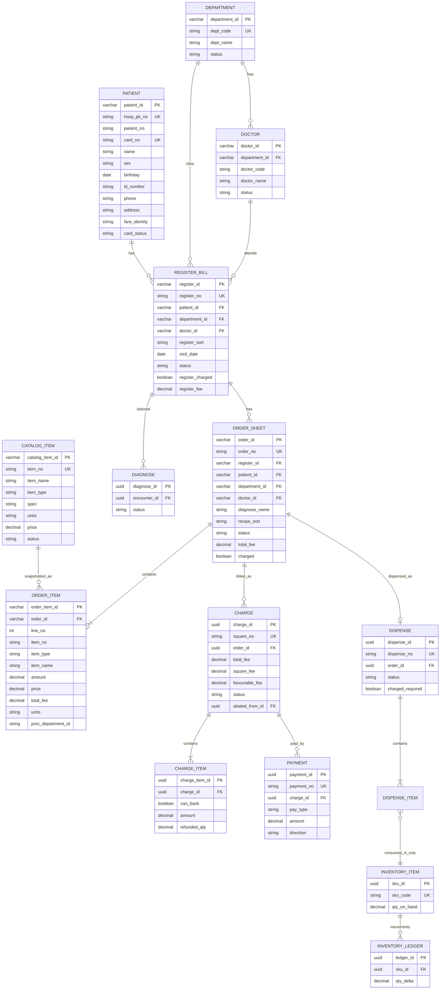

# 数据模型（P1-H03-CORE）

> **状态：草案 v0.3.7（P1-H03-ORDER）** | 日期：2026-10-12（Asia/Shanghai）  
> 编写：H03 | 逻辑模型/状态机/字段语义对齐 H02 + H08；**物理表名不照搬 HERP**  
> 物理类型按 **SQL Server** 示意（已拍板）；经 Store 可切换日后 PostgreSQL  
> 库存：**方案 A 真实扣减**（已拍板）；批次效期延后  
> **v0.3.7**：`catalog_item` / `order_sheet` / `order_item`；`register_id` 主 FK；一期四态 SAVE|COMMIT|PROC|ABATE；拍板#21  
> **v0.3.6**：`department` / `doctor` / `register_bill`；Encounter≡RegisterBill；号源科室+医生（#19）

---

## 1. 六大核心对象总览

| 对象 | 中文 | 说明 | 主键 | 主要业务键 | HERP 对照（逻辑） |
|------|------|------|------|------------|-------------------|
| Patient | 患者 / MPI | 主索引 + 卡状态 | `patient_id` | `hosp_pk_no`；`patient_no`；`card_no`；`id_number` | TPatient / HospPKNo |
| RegisterBill（Encounter） | 就诊（挂号） | 挂号—接诊；**物理表 `register_bill`**；API `/registers`；订单/收费字段名可继续用 encounterId≡registerId | `register_id` | `register_no` | TRegisterBill |
| Order | 医嘱 / 处方 | 门诊开立单据（头+明细；绑挂号） | `order_id` | `order_no` | TCDRecipe / CureBill |
| CatalogItem | 目录 | 药品/治疗目录（开单选项目） | `catalog_item_id` | `item_no` | 药品/治疗目录 |
| Charge（Square） | 费用 / 结算 | 结算单及明细 | `charge_id` | `square_no` | TSquare / Charge |
| Payment | 支付 / 退款分摊 | 收退款记录 | `payment_id` | `payment_no` | TPayment |
| Inventory | 库存 | **方案 A 启用**（真实扣减） | `sku_id` / `ledger_id` | `sku_code` | 发药库存相关 |

可选最小实体：**Diagnose（诊断）** — 见 §3.8。

关联主链：

```
Patient 1──* RegisterBill(Encounter) 1──* Order 1──0..* Charge(Square) 1──* Payment
Department 1──* Doctor ； RegisterBill N──1 Department ； RegisterBill N──1 Doctor
                CatalogItem（目录）供 OrderItem 引用 item_no
                Order 1──0..1 Dispense （发药；关联 Order；须已收费）
                RegisterBill 1──0..* Diagnose （可选）
                Inventory ←── Dispense（仅方案 A）
一张挂号允许多张处方（拍板#21d）
```

> 「一处方多费用」是否启用见假设 A21（待确认）；默认支持 Order→Charge **0..***，不强制 UK(order_id)。

---

## 2. ER 图（Mermaid）



> 方案 A 为基线。若实验降级 StatusOnly，可不写库存表，但验收以真实数量为准。

---

## 3. 实体字段要点

### 3.1 Patient（患者 / MPI）

| 逻辑字段 | 类型（示意 · SQL Server） | 必填 | 说明 | HERP 对照 |
|----------|---------------------------|------|------|-----------|
| patient_id | varchar(64) PK | Y | 代理主键（契约侧可呈 uuid 格式字符串） | — |
| hosp_pk_no | varchar(32) | Y | 院内主索引，全局唯一（过滤未删） | HospPKNo |
| patient_no | varchar(32) | N | 患者编号 | PatientNo |
| card_no | varchar(32) | N | 就诊卡号；**非空时**唯一 | CardNo |
| name | nvarchar(64) | Y | 姓名 | PatientName |
| sex | varchar(8) | Y | `M`/`F`/`U`（一期建档清单必填） | Sex |
| birthday | date | Y | >1900-01-01 且 ≤今天 | Birthday |
| id_number | varchar(32) | N | 身份证等；**非空时**唯一查重 | PersonNo |
| id_type | varchar(16) | N | 如 `ID_CARD` | — |
| phone | varchar(32) | N | 参数可要求必填 | Phone |
| address | nvarchar(256) | N | **选填可空**（H02 建档清单） | Address |
| fare_identity | varchar(32) | Y | 费别（一期建档清单必填） | FareIdentity |
| card_status | varchar(16) | Y | 见 §4.5 | TInsideCardStatus |
| status | varchar(16) | Y | ACTIVE/INACTIVE（主索引启停） | — |
| 审计 / is_deleted | datetime2 / bit | Y | created/updated_at/by；软删 | |

**建档规则（对齐 H02 + 拍板#20）**

| 规则 | 说明 |
|------|------|
| 姓名 / 性别 / 费别必填 | P-01 + 建档清单；API required |
| 生日 >1900-01-01 且 ≤服务器日 | P-02；DB CHECK `>1900-01-01`；≤今天应用层 |
| 身份证非空 → 不得与其它未删患者重复 | P-03；冲突 → `409 DUPLICATE_*`；**拒绝不合并** |
| card_no 非空 → 唯一 | P-04 |
| address 选填可空 | 建档清单；不强制 |
| 重复建档 = **拒绝不合并** | P-07 / A20 / 拍板#20 **已确认** |

### 3.2 Department / Doctor / RegisterBill（挂号）

> 物理表：`dbo.department` / `dbo.doctor` / `dbo.register_bill`（迁移 `003_register`）。  
> 域内 **Encounter ≡ RegisterBill**；API 主路径 `/registers`；订单/收费 `encounterId` ≡ `registerId`。

**Department**

| 逻辑字段 | 类型 | 必填 | 说明 |
|----------|------|------|------|
| department_id | varchar(64) | Y | PK；种子 `dept-1`/`dept-2` |
| dept_code | varchar(32) | Y | UK（过滤 is_deleted=0） |
| dept_name | nvarchar(64) | Y | |
| status | varchar(16) | Y | ACTIVE/INACTIVE |
| 审计 | | Y | created_at/by、updated_at/by、is_deleted |

**Doctor**

| 逻辑字段 | 类型 | 必填 | 说明 |
|----------|------|------|------|
| doctor_id | varchar(64) | Y | PK；种子 `doc-1`/`doc-2` |
| department_id | varchar(64) | Y | FK→department |
| doctor_code | varchar(32) | Y | UK（过滤） |
| doctor_name | nvarchar(64) | Y | |
| status | varchar(16) | Y | ACTIVE/INACTIVE |
| 审计 | | Y | |

**RegisterBill（Encounter）**

| 逻辑字段 | 类型 | 必填 | 说明 | HERP 对照 |
|----------|------|------|------|-----------|
| register_id | varchar(64) | Y | PK（≡旧 encounter_id） | — |
| register_no | varchar(32) | Y | UK（过滤） | RegisterBill 单号 |
| patient_id | varchar(64) | Y | FK→patient RESTRICT | Patient* |
| department_id | varchar(64) | Y | FK→department（拍板#19） | DepartmentId |
| doctor_id | varchar(64) | Y | FK→doctor（拍板#19） | DoctorId |
| register_sort | varchar(32) | N | 号别可选占位（原 clinic_sort） | RegisterClinicSortId |
| visit_date | date | Y | 就诊日 | — |
| status | varchar(16) | Y | 六态见 §4.1；默认 **NORMAL** | TRegisterStatus |
| register_fee | decimal(18,2) | N | 默认 **0** | TotalFee |
| register_charged | bit | Y | 默认 **false/0** | Charged |
| registered_at | datetime2 | Y | | OperateDate |
| back_operator_id | varchar(64) | N | 退号操作员 | BackOperatorId |
| back_operated_at | datetime2 | N | 退号时间 | BackOperateDate |
| 审计 | | Y | is_deleted 等 | OperatorId 等 |

号源：Phase1 **科室+医生简化**（A05 / 拍板#19 **已确认**）——**不建排班号池**；`register_sort` 可空占位。  
退号：默认仅 `NORMAL→BACK`（AC-04）；已用/就诊中等 → `REGISTER_NOT_CANCELLABLE`（AC-03）。

### 3.3 CatalogItem + Order（处方）+ OrderItem（P1-H03-ORDER）

> 物理表：`dbo.catalog_item` / `dbo.order_sheet` / `dbo.order_item`（迁移 `004_order`）。  
> 域内 **encounter_id ≡ register_id**；列名用 `register_id`。一张挂号允许多张处方（#21d）。

**CatalogItem（目录）**

| 逻辑字段 | 类型 | 必填 | 说明 |
|----------|------|------|------|
| catalog_item_id | varchar(64) | Y | PK；种子 `cat-drug-a` / `cat-drug-b` / `cat-treat-1` |
| item_no | varchar(32) | Y | UK（过滤 is_deleted=0）；如 DRUG-A |
| item_name | nvarchar(128) | Y | |
| item_type | varchar(16) | Y | `DRUG` / `TREAT` |
| spec | nvarchar(64) | N | 规格 |
| units | nvarchar(16) | Y | 单位 |
| price | decimal(18,2) | Y | ≥0 |
| status | varchar(16) | Y | ACTIVE / INACTIVE |
| 审计 | | Y | created_at/by、updated_at/by、is_deleted |

**Order（order_sheet）**

| 逻辑字段 | 类型 | 必填 | 说明 | HERP 对照 |
|----------|------|------|------|-----------|
| order_id | varchar(64) | Y | PK | — |
| order_no | varchar(32) | Y | UK（过滤） | RecipeNo |
| register_id | varchar(64) | Y | FK→register_bill；**须**有效（≠BACK）；≡encounter_id | — |
| patient_id | varchar(64) | Y | FK→patient；由挂号带出仍落库 | — |
| department_id | varchar(64) | Y | FK→department；默认挂号科室 | department_id |
| doctor_id | varchar(64) | Y | FK→doctor；默认挂号医生，**允许改**（#21b） | doctor_id |
| diagnose_name | nvarchar(128) | N | **不强制**（#21c） | diagnose_name |
| recipe_sort | varchar(32) | N | 默认 `NORMAL`；毒麻钩子关（A34） | TDrugRecipeSort |
| status | varchar(16) | Y | 一期四态 §4.2：SAVE/COMMIT/PROC/ABATE | TCureBillStatus 子集 |
| total_fee | decimal(18,2) | Y | Σ明细；默认 0 | — |
| charged | bit | Y | 默认 false；true 时不可 abate | — |
| submitted_at | datetime2 | N | Commit 时间 | — |
| abated_at / abated_by | | N | 作废留痕 | — |
| 审计 | | Y | is_deleted 等 | — |

**OrderItem**

| 逻辑字段 | 类型 | 必填 | 说明 | HERP 对照 |
|----------|------|------|------|-----------|
| order_item_id | varchar(64) | Y | PK | — |
| order_id | varchar(64) | Y | FK→order_sheet | — |
| line_no | int | Y | 行号；UK(order_id, line_no) | item_index |
| item_no | varchar(32) | Y | 目录编码快照 | item_no |
| item_type | varchar(16) | Y | `DRUG` / `TREAT` | — |
| item_name | nvarchar(128) | Y | 快照 | item_name |
| spec | nvarchar(64) | N | 规格快照 | drg_spec |
| units | nvarchar(16) | Y | 单位快照 | units |
| amount | decimal(18,3) | Y | 数量；CHECK >0 | amount |
| price | decimal(18,2) | Y | 单价快照；≥0 | price |
| total_fee | decimal(18,2) | Y | 行金额；≥0 | total_fee |
| usage_text | nvarchar(64) | N | 用法 | usage |
| frequency_text | nvarchar(64) | N | 频次 | frequency |
| dosage / dosage_unit | nvarchar | N | 剂量 | dosage |
| proc_department_id | varchar(64) | N | 执行科室 | proc_department_id |

流程：Save→Commit→（收费后）Proc（发药）；作废 ABATE（仅未收费）。**处方审核一期跳过**。开单库存仅提示不拦。

### 3.4 Charge / Square + ChargeItem

| 逻辑字段 | 类型 | 必填 | 说明 | HERP 对照 |
|----------|------|------|------|-----------|
| charge_id | UUID | Y | PK | — |
| square_no | varchar(32) | Y | UK 结算单号 | SquareNo |
| order_id | UUID | N* | FK；从已提交处方载入 | — |
| patient_id | UUID | Y | 冗余便于查询 | — |
| encounter_id | UUID | **Y** | **必填**；有效挂号/就诊（C-07 / H08）；无 Encounter 不可创建/支付 | — |
| total_fee | decimal(18,2) | Y | | TotalFee |
| square_fee | decimal(18,2) | Y | 应收/实收策略口径 | SquareFee |
| favourable_fee | decimal(18,2) | Y | 优惠，默认 0 | FavourableFee |
| status | varchar(16) | Y | NORMAL / ABATE | TSquareStatus |
| abated_from_id | UUID | N | 若本单由退费生成，指向被作废原单；或反向由原单记 successor | — |
| successor_square_id | UUID | N | 作废后生成的新单（未退部分） | AbateSquareBill 新单 |
| 审计 | | Y | | |

\* 允许多 Charge 关联同一 Order（A21 待确认）；不建强制 `uk_charge_order`。

**ChargeItem**

| 逻辑字段 | 类型 | 必填 | 说明 | HERP 对照 |
|----------|------|------|------|-----------|
| charge_item_id | UUID | Y | PK | — |
| charge_id | UUID | Y | FK | — |
| order_item_id | UUID | N | FK | — |
| item_no | varchar(64) | Y | | — |
| amount | decimal(18,3) | Y | 数量；须 >0 | Amount |
| price | decimal(18,2) | Y | | — |
| total_fee | decimal(18,2) | Y | | — |
| can_back | boolean | Y | 可退标记 | CanBack |
| refunded_qty | decimal(18,3) | Y | 已退数量，默认 0 | BackAmount 相关 |

**退费不变量**：
- 对齐 H02 **B-03** / H08：作废原 Square（→ABATE，写 `successor_square_id`）+ **同事务**生成新 Square（`abated_from_id`→原单）承接未退部分；仅处理 `can_back=true`；支持部分数量退。
- 对齐 H02 **B-08**：已发药明细须先退药再退费（`REFUND_REQUIRES_RETURN` **已确认强制**）。
- 对齐 H02 **B-09** / H08《金额核对点》§4：优惠分摊策略枚举预留 `PROPORTIONAL` | `DISCOUNT_ON_REMAIN` | `DISCOUNT_FIRST`；**推荐草稿 = PROPORTIONAL（非用户已拍板）**。  
  - Phase1：\(F=0\) 可硬断言 K-01～K-15；\(F>0\) 走可配置策略，期望值 **待用户经 H01 确认**（A35）。  
  - 结构字段 `successor_square_id` / `abated_from_id` / `refunded_qty` 已定。

### 3.5 Payment

| 逻辑字段 | 类型 | 必填 | 说明 |
|----------|------|------|------|
| payment_id | UUID | Y | PK |
| payment_no | varchar(32) | Y | UK |
| charge_id | UUID | Y | FK → 当前有效/被操作的 Square |
| direction | varchar(8) | Y | `CHARGE` / `REFUND` |
| pay_type | varchar(16) | Y | Phase1（C-08 / H08）：演示 `CASH`；电子字段（`OTHER_E`/`WECHAT`/`ALIPAY`）预留可落库、**不联调** |
| amount | decimal(18,2) | Y | ≥0；方向用 direction；非法 → `INVALID_AMOUNT` |
| status | varchar(16) | Y | PENDING / **SUCCEEDED**（支付/退费成功） / FAILED |
| succeeded_at | timestamptz | N | |
| 审计 | | Y | |

### 3.6 Dispense + DispenseItem

| 逻辑字段 | 类型 | 必填 | 说明 | HERP 对照 |
|----------|------|------|------|-----------|
| dispense_id | UUID | Y | PK | — |
| dispense_no | varchar(32) | Y | UK | — |
| order_id | UUID | Y | FK | — |
| status | varchar(16) | Y | 与发药/退药相关；处方侧同步 PROC / RECIPE_UNCHECK | TDrugDispense* |
| charged | boolean | Y | 须为 true 才可发 | Charged |
| dispensed_at | timestamptz | N | | ProcBill |
| return_reason | varchar(256) | N | 退药原因 | UnCheckReason |
| 审计 | | Y | | |

规则：发药前 CheckStorages；ProcBill；发药数量 ≤ 已收费可发数量（D-04 验收覆盖）。

### 3.7 Inventory（仅方案 A）

Phase1 **总量模型**（A13）：一药品一 SKU，不做批次/效期。

| 实体 | 要点 |
|------|------|
| InventoryItem | sku_id, sku_code UK, name, qty_on_hand≥0, row_version |
| InventoryLedger | ledger_id, sku_id, qty_delta（发药负/退药正）, ref_type, ref_id, 审计 |

方案 A 已拍板启用。`Inventory:Mode=StatusOnly` 仅实验降级，非 Phase1 默认。

### 3.8 Diagnose（可选最小实体）

| 逻辑字段 | 类型 | 必填 | 说明 | HERP 对照 |
|----------|------|------|------|-----------|
| diagnose_id | UUID | Y | PK | — |
| encounter_id | UUID | Y | FK | — |
| status | varchar(16) | Y | NEW/SAVE/COMMIT/ABATE | TCDPatientDiagnoseStatus |
| content | text | N | 诊断摘要 | — |
| 审计 | | Y | | |

Upload 上报延后。Phase1 可不建表，仅预留状态枚举与可选 API。

---

## 4. 状态枚举表（对齐 H02）

### 4.1 RegisterBill.status（对齐 TRegisterStatus；Encounter≡RegisterBill）

| 值 | HERP | 含义 | 允许转入 |
|----|------|------|----------|
| NORMAL | rssNormal=1 | 正常号 | USED, DIAGNOSING, PAUSED, BACK |
| USED | rssUsed=2 | 已用 | DIAGNOSING, BACK* |
| BACK | rssBack=3 | 退号（终态） | — |
| DIAGNOSING | rssDiagnoseing=4 | 就诊中 | DIAGNOSED, PAUSED, BACK* |
| DIAGNOSED | rssDiagnosed=5 | 就诊完成 | BACK* |
| PAUSED | rssPause=6 | 挂起 | DIAGNOSING, BACK* |

\* BACK：已是 BACK → 拒绝再退；USED/DIAGNOSING/DIAGNOSED/PAUSED **默认拒绝退号**（参数可放开，对齐 PARM_REGISTER_ALLOW_BACK_USED）。

NORMAL→USED 精确触发点仍待确认（H02 待确认#5）；契约允许 NORMAL 直接→DIAGNOSING。

### 4.2 Order.status（一期四态；对齐 TCureBillStatus 子集）

| 值 | HERP | 含义 | 允许转入 |
|----|------|------|----------|
| SAVE | csSave=1（含新建） | 暂存；不可收费 | COMMIT, ABATE |
| COMMIT | csCommit=2 | 已提交；**可收费** | PROC, ABATE（未收费） |
| PROC | csProc=3 | 执行（发药成功） | —（退药链后续片） |
| ABATE | csAbate=4 | 作废（终态） | — |

> **一期不入库**：NEW / UNDO / RECIPE_CHECK / RECIPE_UNCHECK（审核跳过；退药反审核后续片再扩 CHECK）。  
> DB CHECK：`status IN ('SAVE','COMMIT','PROC','ABATE')`（`004_order`）。

主路径：Save→Commit→（收费）→Proc；作废 ABATE（仅 charged=false）。

### 4.3 Charge.status（对齐 TSquareStatus）

| 值 | HERP | 含义 | 允许转入 |
|----|------|------|----------|
| NORMAL | ssNormal=1 | 正常 | ABATE |
| ABATE | ssAbate | 作废（终态） | — |

退费成功：原单 → ABATE；未退部分 → **新** Square(NORMAL)。已 ABATE 不可再作废（查无/空则失败）。

### 4.4 Payment.status

| 值 | 含义 | 允许转入 |
|----|------|----------|
| PENDING | 处理中 | SUCCEEDED, FAILED |
| SUCCEEDED | 成功 | — |
| FAILED | 失败 | — |

### 4.5 Patient.card_status（对齐 TInsideCardStatus）

| 值 | HERP | 含义 |
|----|------|------|
| NOT_SENT | icsNotSend | 未发卡 |
| NORMAL | icsNormal | 正常 |
| LOST | icsLose | 挂失 |
| CANCELLED | icsLogOff | 注销 |

非 NORMAL 时部分支付路径拒绝（H02 C-05）。

### 4.6 Diagnose.status

| 值 | 含义 | 允许转入 |
|----|------|----------|
| NEW | 新建 | SAVE, ABATE |
| SAVE | 保存 | COMMIT, ABATE |
| COMMIT | 提交 | ABATE |
| ABATE | 作废 | — |

### 4.7 Dispense 业务状态（应用层；与 Order 联动）

发药成功：Order→PROC；退药：Order→RECIPE_UNCHECK，并记 return 留痕。可用 dispense 侧 `READY/DISPENSED/RETURNED/PARTIAL_RETURNED` 辅助查询，但**权威状态以 Order.status 对齐 CureBill 为准**。

---

## 5. 关键关联与不变量

1. 开单/收费闭环：**须**存在有效 RegisterBill（status≠BACK）；禁止无挂号直接收费/开单（A27/C-07/拍板#21a **已确认**）；退号 BACK → `ENCOUNTER_REQUIRED`。  
2. Order 仅 SAVE 可改明细；COMMIT 后改价须走作废/退费链路；已收费不可 abate（`ORDER_CHARGED_NOT_ABATABLE`）。一张挂号多处方（#21d）。  
3. 发药：须 charged=true（存在覆盖该处方的 NORMAL Square）；CheckStorages；数量 ≤ 可发。  
4. 退费：仅 can_back；部分数量；**同事务** Abate 旧 Square + 新 Square；**已发药须先退药**（B-08）；优惠分摊策略枚举预留（H08 草稿，A35 **待用户确认**）；\(F=0\) 可硬断言。  
5. 退号：BACK 终态；默认禁止对 USED/DIAGNOSING/DIAGNOSED/PAUSED 退号。  
6. 方案 A：`qty_on_hand` 扣减后 ≥0；ledger 只追加。  
7. 金额：禁止 float；合计=Σ行（HalfUp 到分，A08 待拍板）。  
8. 毒麻精抗处方权校验本版关闭（A34）；feature flag 默认 off。

---

## 6. 随 H02 / 用户后续关注点

- ~~号源排班（A05）~~ → 已关闭（#19 科室+医生）  
- 一处方多费用 / 拆方（A21）  
- **★ 部分退优惠分摊策略（A35 / B-09）— H08 已交草稿（PROPORTIONAL 等），仍待用户经 H01 确认**  
- 挂号 NORMAL→USED 触发点  
- （已关闭）未挂号收费（A27）、已发药须先退药（A10）、支付方式（A09）、毒麻精抗（A34）

---

*v0.3.7 — catalog_item + order_sheet + order_item；register_id；四态；拍板#21；004_order。*
