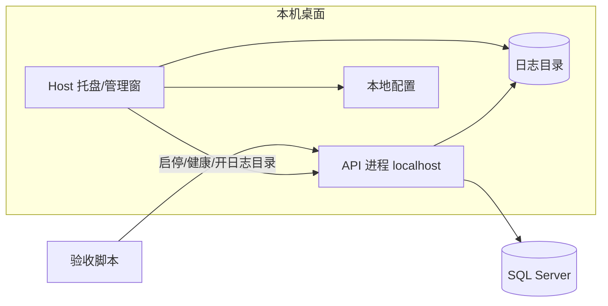

# 架构方案草案（P1-H03-CORE）

> **状态：草案 v0.3.1（对齐 H02 初稿 + 用户拍板 1–9）** | 日期：2026-10-12（Asia/Shanghai）  
> 编写：H03 | 任务：P1-H03-CORE  
> 依据：`00-范围草案.md`、H02 初稿、`03-用户拍板.md`（项 1–9）  
> **已拍板基线：Go + SQL Server（Store 可切换）+ 库存方案 A + 先接口 + 桌面 Host + 落盘日志；本地 `E:\B-HIS`；GitHub 每版上传；HERPCore 暂不用**  
> 完成邮件由 **H01** 发送（拍板#7），**非 H03 职责**。

---

## 1. 目标与边界

### 1.1 目标

为门诊闭环（建档 → 挂号 → 开单 → 收费 → 发药 → 退药/退费）提供可实现、可测试的架构边界与已锁定技术基线，供 H04 在契约稳定后实现 **桌面 Host + API**。

### 1.2 范围内

- 六大核心对象 + 可选诊断；状态机对齐 H02
- Go API + SQL Server + **Store 切换接口**（日后 PG/国产库）
- 库存方案 A（真实可核对数量）；批次效期/采购延后
- 桌面版本地 Host（托盘/管理窗）+ 同机 API
- 运行日志落盘可查；业务 audit 表
- OpenAPI 契约优先验收

### 1.3 范围外

- 住院、医保、LIS/PACS、完整 EMR、采购/批次效期
- 门诊业务 UI（**H05 暂缓**）；发信/邮件模块（归 H01）
- 修改 HERP；**HERPCore 暂不用**

### 1.4 演示

**先接口后界面**：脚本/curl 直打 API；Host 便于现场启停与查日志，不替代契约验收。

---

## 2. 已拍板技术基线

### 2.1 锁定项（`03-用户拍板.md`）

| # | 事项 | 决定 |
|---|------|------|
| 1 | 技术栈 | 后端 **Go**；前期 **SQL Server**；Store 可切换；业务层不绑驱动；前端暂缓，预留 Vue 3 |
| 2 | 简易库存 | **要做（方案 A）**；总量可核对；批次效期/采购延后 |
| 3 | 演示 | **先接口后界面**；H05 暂缓 |
| 4 | HERPCore | **暂不用** |
| 5 | 运行形态 | **桌面版** Host（托盘/管理窗）+ 同机 API |
| 6 | 日志 | **必须落盘可查** |
| 7 | 工作汇报邮件 | **H01 发送**；非 H03 职责 |
| 8 | 项目路径 | 实现工程根 **`E:\B-HIS`**（Windows 本机） |
| 9 | 版本管理 | 每次版本改动 **commit + push** 到 **`https://github.com/cznUSER/B-HIS.git`**；建议 `main` + tag `v0.x.y` |

### 2.2 相对原甲/乙/丙取舍

| 原选项 | Phase1 取舍 |
|--------|-------------|
| 甲 .NET8+PG | 不选：非 Go；前期非 PG |
| 乙 .NET8+SQL Server | 不选 .NET；库为 SQL Server 与乙部分重合，运行时改 Go |
| 丙 Java+PG | 不选 |
| 传言 Go+PG | 采纳 Go；前期用 SQL Server；PG 为后续 Store 目标 |

### 2.3 推荐组件（示意）

| 层 | 建议 |
|----|------|
| 语言 | Go 1.22+ |
| HTTP | net/http + chi/echo/gin 之一 |
| OpenAPI | `openapi/openapi.yaml`；oapi-codegen 可选 |
| DB | SQL Server 2019/2022 |
| 迁移 | golang-migrate 或 goose（SQL Server） |
| 驱动 | database/sql + go-mssqldb；仅 Store 层 |
| Host | 托盘/管理窗（Walk/Wails/Fyne/原生等，实现期选定） |
| 演示 | curl / 脚本；无业务 UI |

### 2.4 运行形态：Host vs API（拍板#5）



| 组件 | 职责 | 不职责 |
|------|------|--------|
| **Host** | 启停/重启 API；健康状态（地址、版本、DB 粗检）；打开日志目录；指向本地配置（DSN、端口、日志路径）；异常提示 | 门诊业务 UI；替代 OpenAPI |
| **API** | 实现契约；领域/应用/Store；写 audit；写运行日志 | 依赖 Host UI 才能服务（须可无头运行） |
| 关系 | 同机 `http://127.0.0.1:<port>/api/v1`；同安装包两入口或 Host 拉子进程 | 非必须装成 Windows 服务 |

验收不强制打开 Host。

### 2.5 工程落盘与版本库（拍板#8 · #9）

- **实现代码**落盘 Windows 本机 **`E:\B-HIS`**（Go module 根；Host + API）。
- **契约草案**仍可在 `/workspace/H-project/phase1/deliverables/h03/`；实现期将 OpenAPI/迁移同步进 `E:\B-HIS`。
- **GitHub**：远端 `https://github.com/cznUSER/B-HIS.git`；**每次版本改动须 push**（契约破坏性变更、迁移版本、可运行构建标签等）。详见 `工程约定.md` §2.0。

---

## 3. 分层与模块

| 层 | 职责 |
|----|------|
| 适配（HTTP/脚本） | 鉴权、DTO、幂等键 |
| 应用 | 用例、UnitOfWork、权限 |
| 领域 | 实体、状态机；纯 Go |
| 端口 | PatientStore / EncounterStore / OrderStore / ChargeStore / DispenseStore / InventoryStore / AuditStore |
| 基础设施 | mssql Store（默认）、迁移、日志落盘、Host |

模块：MPI、Encounter、Order、Billing、Pharmacy（含 Inventory）、Identity、Audit。单体部署。

---

## 4. Store / Repository 切换接口

### 4.1 目标

业务层不依赖驱动与 SQL 方言；Phase1 `store/mssql`；后续 `store/postgres` 等不改用例。

### 4.2 端口示意

```go
type UnitOfWork interface {
    WithinTx(ctx context.Context, fn func(ctx context.Context, tx Tx) error) error
}
type ChargeStore interface {
    AbateAndCreateSuccessor(ctx context.Context, tx Tx, oldID ID, successor *Charge, items []ChargeItemPatch) error
}
type InventoryStore interface {
    CheckAndDeduct(ctx context.Context, tx Tx, sku string, qty Decimal) error
    AddBack(ctx context.Context, tx Tx, sku string, qty Decimal) error
}
// PatientStore / EncounterStore / OrderStore / PaymentStore / DispenseStore / AuditStore ...
```

工厂：`NewSQLServerStores(db)` / 日后 `NewPostgresStores(db)`；`DB_DRIVER` 仅在 main 组装读取。

### 4.3 方言与迁移

- 占位符、锁提示、类型转换封装在 Store  
- Phase1 仅 SQL Server 迁移脚本；PG 平行目录后续加  
- `migrations/inventory/` **启用**（方案 A）

---

## 5. 事务边界（对齐 H02）

| 用例 | 事务内 |
|------|--------|
| 建档 | patient + 唯一约束（冲突拒绝） |
| 挂号 | encounter=NORMAL |
| 开单提交 | order→COMMIT |
| 收费 | Square NORMAL + payment |
| 发药 A | dispense + CheckAndDeduct + PROC |
| 退药 A | return + AddBack + RECIPE_UNCHECK |
| 退费 | **AbateAndCreateSuccessor** + REFUND（同事务；CanBack） |

---

## 6. 库存方案 A（已拍板）

总量 `inventory_item` + `inventory_ledger`；发药扣减、退药回滚；无批次效期；API `/inventory/**` 启用。

---

## 7. 标识与金额

UUID（或雪花待定）；业务单号全局唯一；金额精确 decimal，禁 float。

---

## 8. 待确认残留

1. 号源简化（A05）  
2. 未挂号开单（A27）  
3. 已发药是否必须先退药（A10）  
4. 一处方多费用（A21）  
5. A01/A08 实现微调  

技术栈/库存/演示/HERPCore/Host/日志/本地路径/GitHub **已拍板**（项 1–9）。

---

## 9. 运行日志（拍板#6 · 摘要）

| 项 | 约定 |
|----|------|
| 必须 | 落盘可查；Host 可打开日志目录 |
| 级别 | debug / info / warn / error |
| 分工 | **audit 表**=业务事实；**log 文件**=运行可观测 |
| 字段/路径/滚动 | 见 `工程约定.md` §8 |

---

## 10. 修订说明

| 版本 | 日期 | 说明 |
|------|------|------|
| v0.1 | 2026-10-12 | 初稿；甲乙丙待拍板 |
| v0.2 | 2026-10-12 | 对齐 H02 |
| v0.3 | 2026-10-12 | 拍板 1–7：Go+SQL Server+Store；库存 A；先接口；HERPCore 暂不用；桌面 Host；落盘日志；邮件归 H01 |
| v0.3.1 | 2026-10-12 | 拍板 #8/#9：实现根 `E:\B-HIS`；远端 `https://github.com/cznUSER/B-HIS.git`；每版 push |

---

*v0.3.1 已拍板基线（1–9）；H04 在 `E:\B-HIS` 组装 Go Host + API + SQL Server Store，并 push 至 GitHub。*
